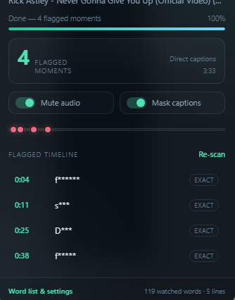

# CleanVid

**Profanity off. Everything else on.**

CleanVid is a Chrome/Edge extension that **listens to the audio** of YouTube videos with on-device speech recognition, finds flagged words, and mutes each one with word-level precision. It also scans closed captions as a second source and can mask words on screen.

Everything runs locally: there is no CleanVid server, and audio and transcripts never leave your computer. The speech models are a one-time download from Hugging Face (≈ 175–300 MB, depending on your hardware).

<p align="center">
  
</p>

## Why audio?

Caption-based filters miss a lot. YouTube's auto-captions replace many swear words with `[ __ ]` or drop them, manual captions are often cleaned up, and caption timing is loose (±300 ms or worse). CleanVid 2 works from the sound itself:

```
YouTube player ──appendBuffer──▶ audio segments (timestamps from the container)
  ▶ decode (16 kHz mono)
  ▶ Whisper              what was said
  ▶ word-list matcher    which words are flagged
  ▶ wav2vec2 CTC         exactly when (≈ 20 ms frames)
  ▶ Web Audio gain       scheduled fade-to-silence (or bleep)
```

## Preview

<p align="center">
  
</p>

## Features

The toolbar icon and bottom-right button toggle the same floating panel. The button stays visible while the panel is open. Flagged words start collapsed below the timeline; click Show flagged words to expand them. Outside a YouTube video, the toolbar opens settings.

- **On-device audio detection** (new in 2.0)
  - Captures the audio the YouTube player already buffers (it works with DASH and SABR streaming). Nothing extra is downloaded from YouTube.
  - **Whisper** (base or small, English) transcribes. A completeness check re-transcribes a window in halves if Whisper stopped early.
  - **wav2vec2** forced alignment pins each word to its audio frames. Its language-model-free greedy transcript also catches words Whisper softened or skipped (exact matches only).
  - **WebGPU** acceleration when available, with a multithreaded WASM fallback.
  - **Playhead-first scheduling.** The window under the playhead goes first, then the audio ahead, then anything earlier. Seeking re-prioritizes immediately.
  - **Saved analysis per video** (IndexedDB). Refreshing, revisiting or seeking never repeats speech recognition. Changing the word list re-matches the saved transcript instantly.
  - **Sample-accurate muting** through a Web Audio gain node with ~8 ms fades, or an optional bleep. Falls back to `video.muted` if Web Audio is unavailable.
  - A **pipeline panel** shows Capture → Transcribe → Align → Mute, how far ahead of you the analysis is, and a coverage bar on the timeline.
  - Optional **"pause until analyzed"**, for playback that reaches audio not yet analyzed.
- **Caption analysis** (still on, as a second opinion)
  - Scans the selected track plus English manual, auto-generated and YouTube-translated tracks.
  - Uses YouTube's `[ __ ]` censorship markers as timed hits.
  - Caption hits are dropped where the audio already found the same moment, because audio timing wins. Elsewhere they are kept, so nothing is lost.
  - Transcript-panel fallback and optional OpenSubtitles lookup.
- **Fuzzy matching**, which catches censored and creative spellings: `f*ck`, `sh1t`, `a$$`, `f u c k`, `mother-fucker`, plus controlled typo tolerance.
- **Editable word list** with bulk editing, three sensitivity levels, and a live matcher tester.
- **Caption masking** in the player and the transcript panel.
- **Private by default:** no telemetry and no remote code. Model weights are data, the ONNX runtime is bundled, and model revisions are pinned to exact commits.

## Install (unpacked)

1. Download or clone this folder.
2. Open `chrome://extensions` in Chrome, or `edge://extensions` in Edge.
3. Turn on **Developer mode**.
4. Click **Load unpacked** and select the `CleanVid` folder.
5. A welcome page opens. Pick a model pack and click **Download & enable**, or choose **Not now** to use captions only.
6. Open any YouTube video. The CleanVid panel appears at the bottom right.

> Chrome/Edge 116 or newer is required (Manifest V3, offscreen documents, `world: "MAIN"` content scripts). WebGPU is used when the browser offers it.

### Model packs

| Pack | Speech model | Aligner | Download (GPU / CPU) |
|---|---|---|---|
| **Standard** (recommended) | `onnx-community/whisper-base.en` | `Xenova/wav2vec2-base-960h` | ≈ 300 MB / ≈ 175 MB |
| **High accuracy** | `onnx-community/whisper-small.en` | `Xenova/wav2vec2-base-960h` | ≈ 680 MB / ≈ 345 MB |

Models are stored in the extension's Cache Storage. Switch or remove them in **Settings → Audio detection**.

## Using CleanVid

On a YouTube watch page, the floating panel shows:

- **Status**: Listening (audio still being analyzed), Ready (the whole video is analyzed), Preparing (paused until analyzed), or the caption state
- **Pipeline**: Capture → Transcribe → Align → Mute, the window being worked on, and how far ahead of the playhead the analysis is
- **Coverage bar**: buffered (blue), analyzed (green) and in progress (pulsing), with the playhead and one tick per flagged moment
- **Flagged moments**: each row says whether it was `heard` (audio) or came from `cc` (captions). Click it to jump there.
- **Mute audio / Mask captions** quick toggles

The **settings page** adds:

- **Audio detection**: on/off, model pack, download/remove, silence or bleep, audio mute padding (default 70 ms), pause until analyzed, experimental whole-video pre-scan, and the saved-analysis cache (with a Clear button)
- playback toggles, caption mute padding, caption language, sensitivity, caption sources, and the word list manager

## How it works

### Audio capture

`src/content/bridge.js` runs in the page's JavaScript world at `document_start` and wraps `MediaSource.addSourceBuffer` and `SourceBuffer.appendBuffer`. Every audio append (WebM/Opus or fragmented MP4/AAC) is copied and forwarded to the content script. Appends made before the content script is ready are replayed from a bounded buffer. Ad playback is skipped: the player's ad state is checked, and the duration of each MediaSource is compared with the video's.

`src/shared/media.js` turns the raw append stream, which may arrive as arbitrary byte slices, into self-contained units: one WebM Cluster or one MP4 `moof`+`mdat` pair. Each unit carries its presentation time (container timestamp plus `timestampOffset`) and its exact duration, taken from the Opus packet headers or MP4 `trun` sample durations. When the browser's decoder drops pre-skip or priming samples, the gap between expected and decoded length is used to correct the start time.

### Engine (offscreen document)

`src/engine/engine.js` is a single engine shared by all tabs. It:

1. keeps audio units per video and frees them once they are analyzed;
2. picks the next window of up to 27 s, with 1 s of context on each side (`Timeline.nextWindow`): playhead first, then forward, then earlier gaps;
3. decodes the window to 16 kHz mono;
4. runs wav2vec2 (CTC emissions, ~20 ms frames), then Whisper. If Whisper returned far fewer words than wav2vec2 heard, it splits the window at the quietest point and re-transcribes;
5. force-aligns Whisper's words to the CTC emissions with Viterbi (`src/shared/align.js`). Each character is limited to the frames where the model actually hears it, so a word can't absorb untranscribed speech;
6. commits only the words whose midpoint falls inside the window, merges coverage, and streams the words to every tab watching that video;
7. persists `{coverage, words, ctcWords}` per video in IndexedDB (LRU, 400 videos). A cached transcript is discarded only when the model pack or `PIPELINE_VERSION` changes.

### Matching and muting

The content script runs the existing matcher over the aligned words (`Timeline.matchWords`), merges them with acoustic-only and caption hits (`Timeline.combine`), and builds mute intervals. Audio hits use the small audio padding and caption hits use the caption padding.

The bridge routes the `<video>` through a `GainNode`. If YouTube itself creates a `MediaElementSource`, the gain is spliced into YouTube's graph instead. The bridge plans the gain automation 20 s ahead on the AudioContext clock, with 8 ms linear fades, and re-plans on seek, pause, rate changes and clock drift. Muting stays exact even when timers are throttled in background tabs. Until Web Audio can start (it needs a user gesture), muting falls back to `video.muted`.

### Matching details

- Whole-token matching means `ass` never matches `class` or `assume`.
- Tokens are Unicode-normalized, lowercased, leetspeak-folded and de-stretched.
- Masks (`*`, `#`, `•`, `·`) match any character and may stand for zero characters.
- Apostrophes split tokens, so `he'll` never becomes `hell`.
- Multi-word entries match split compounds (`dumb ass` → `dumbass`).
- Split-letter spellings (`f u c k`, `f.u.c.k`) are reassembled.
- Fuzzy matching depends on sensitivity: **Strict** (exact only), **Smart** (one edit for 6+ letters, two for 9+), **Aggressive** (one edit for 4+, two for 7+).
- A large allowlist blocks innocent look-alikes (`burger`, `shut`, `walking`, `wanted`, …).

## Privacy

- **Audio and transcripts stay on your device.** Speech recognition runs in the extension's offscreen document. Transcripts are stored in the extension's IndexedDB and can be cleared in Settings.
- **Model download:** the models are fetched once from `huggingface.co` at pinned revisions, when you click Download. No audio, video IDs or other data are sent.
- **Settings and the word list** live in `chrome.storage.local`. So does the OpenSubtitles API key, if you add one (browser storage is not an encrypted secrets vault).
- **OpenSubtitles** (off by default) sends the video title and your API key to `api.opensubtitles.com`. A public release needs a terms-compliant API key strategy; see the [OpenSubtitles integrator terms](https://opensubtitles.stoplight.io/docs/opensubtitles-api/branches/master/f43c0749230b3-terms-of-use-for-integrators).
- **Experimental whole-video pre-scan:** where YouTube exposes a direct audio URL in the player response, the page fetches it from YouTube's own servers. Nothing goes anywhere else.

## Development

```bash
npm test            # unit tests: matcher, caption parsers, media parsing, CTC alignment, scheduling
npm run check       # manifest, file references, syntax, icon dimensions
npm run e2e         # headless Chrome smoke test with mocked captions (no models needed)
npm run e2e:audio   # real YouTube video through the full audio pipeline (downloads models once)
npm run icons       # regenerate the PNG icons
```

`e2e:audio` uses a persistent test profile in the OS temp folder, so the models download only once. Pass `--fresh` to start from a new profile, or `--keep-cache` to keep saved analysis. In the test browser only, it removes ad fields from YouTube's player response so content plays first. It checks that the baseline words are heard within ±0.5 s and that reloading reuses the saved analysis without re-transcribing.

Diagnostics: `__cleanvidEngine.summary()` in the offscreen document's DevTools (`chrome://inspect/#other`), and `__cleanvidGain()` in the YouTube page console.

Project layout:

```
manifest.json
icons/
vendor/transformers/        transformers.js 4.3.2 + ONNX Runtime Web (WASM), bundled
src/
  background/service-worker.js   badge, onboarding, offscreen engine lifecycle
  content/
    bridge.js                    MAIN world: captions, MSE audio capture, Web Audio muting
    content.js                   matching, merging, fallback muting, masking, panel
    panel.css
  engine/                        offscreen document: decode, Whisper, wav2vec2, scheduler, cache
  onboarding/                    first-run model setup
  options/                       settings dashboard (+ audio-settings.js)
  shared/
    align.js                     CTC forced alignment, greedy decoding, text normalization
    captions.js                  JSON3 / XML / VTT / SRT parsers
    constants.js                 defaults, model packs, storage helpers
    engine-client.js             content/page ↔ engine port with reconnects
    matching.js                  profanity matcher
    media.js                     WebM / fMP4 stream parsing into timed audio units
    timeline.js                  ranges, window scheduling, transcript matching, source merging
tests/
tools/
docs/PLAN-v2.md                  design notes for the audio pipeline
```

## Limitations

- **Analysis follows the player's buffer.** YouTube's web player now streams over SABR and exposes no direct audio URLs, so the whole-video pre-scan almost never applies. CleanVid analyzes what the player has buffered, usually 30–120 s ahead, plus anything you seek to. Results are saved, so coverage only grows.
- **The first seconds of a new video** may play before their first window is analyzed. Caption hits still cover them, and **Pause until analyzed** closes the gap completely.
- **English speech models.** The packs are English-only (`.en`). Other languages still get caption matching.
- **Hardware.** Without WebGPU, the CPU fallback is several times slower. It is usually still faster than real time on modern machines, but not on all of them.
- **Hard audio.** Loud music, overlapping speakers and heavy accents lower recall. The acoustic-only and caption passes help, but they are not perfect.
- **Ads** are not analyzed or muted.
- **Not a guarantee.** Review the word list and sensitivity if a word is missed or an innocent word is flagged.

## Troubleshooting

**The panel says "Catch every swear word — Set up"**
The speech models aren't installed. Click **Set up** (or open Settings → Audio detection) and download a pack.

**Muting seems late on the first word after opening the page**
Web Audio can only start after you interact with the page. Until then, CleanVid uses the coarser `video.muted` path. Click the player once; later mutes are sample-accurate.

**"No captions found"**
Audio detection still works. For caption analysis, turn on CC once or open **Show transcript**, then press **Re-scan**.

**YouTube updated and something stopped working**
Open an issue with the video URL and the panel's message. Capture and muting are isolated in `src/content/bridge.js` so they can be repaired quickly.
